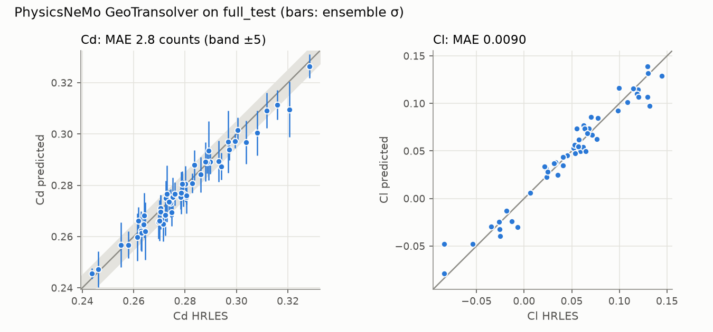

# aerosurr

A multi-fidelity 3D surface-flow surrogate on [DrivAerML](https://huggingface.co/datasets/neashton/drivaerml):
it predicts time-averaged surface Cp and wall shear stress on a full car from geometry,
corrects a coarse in-house OpenFOAM RANS towards the dataset's HRLES, and reports
deep-ensemble uncertainty. The design and the plan are in [SPEC.md](SPEC.md).

**Headline (50 held-out `full_test` cars, native 7–10 M-cell meshes):** NVIDIA PhysicsNeMo
GeoTransolver, selected on `full_val`, predicts surface Cp with 6.1 % relative L2 error.
Integrated drag is within **2.8 drag counts** on average (max 11.2, Cd R² 0.96), against
21.8 counts for an in-house PointNet baseline; PhysicsNeMo Transolver reaches 3.9 counts.
A calibrated deep ensemble of 5 GeoTransolvers brings the drag error to **1.9 counts**
(Cd R² 0.98), with per-cell 90 % intervals covering 90–91 % of the true values.
For design ranking, GeoTransolver orders 98.6 % of test-car pairs at least 5 counts apart
correctly (coarse RANS: 84.9 %) and picks the true lowest-drag car.
Full tables, data efficiency, the multi-fidelity study and calibration are in
[docs/results.md](docs/results.md). An interactive 3D viewer is published privately as a
claude.ai artifact.



**Status: Day 1 done.** Every one of the 484 runs passes the physics gate (integrated
forces match DrivAerML's reference CSVs to ≤ 8e-7). The 100-case coarse RANS batch, the
deep ensemble and the MF study (3 seeds per model) are done. Feeding RANS fields into
the network did not pay off for fields: the MF model's shear errors are higher than an
HF-only model's in every seed at 11, 25 and 50 training cars, and so are its pressure
errors from 25 cars. Its one clear win is drag with 11 training cars (8.9 ± 0.4 against
15.9 ± 1.4 counts). From 25 cars the drag difference is within seed spread. A scalar
Cd correction of the RANS (8.3 counts) is competitive up to 25 cars. On the official `geometry` out-of-distribution split,
a separately trained ensemble's σ rises in step with its error and flags the unfamiliar
cars (AUROC 0.82 for per-car mean σ(Cp)). That shift is mild, though: Cd error goes
from 2.0 to 2.6 counts.

## Quick start (workstation-III)

```bash
. ~/aero/env.sh                      # uv on PATH, caches under ~/aero
make sync                            # .venv from uv.lock, torch 2.14.1+cu132
make check                           # ruff + mypy + CPU tests
make gpu-check                       # docs/gpu_check.md
make inspect                         # docs/data_inspection.md (inspection gate, SPEC §4.5)
make download                        # T0 + T2 in tmux `aero-dl`; `make status` for progress
```

Every capability is a CLI command: `uv run aerosurr --help`.

| Command | What it does |
|---|---|
| `aerosurr env check` | GPU idle check, torch/CUDA build, bf16 GEMM TFLOPS, `torch.compile` smoke test per GPU |
| `aerosurr env probe` | side-load probe (VTP preprocessing + GPU training steps) on given cores |
| `aerosurr data download -t t0 -t t2` | resumable, revision-pinned, sha256-verified download, bound to `net.bind_interface` |
| `aerosurr data status` | per-tier download progress (offline) |
| `aerosurr data inspect FILE` | every array of a boundary VTP with dtype/shape/stats; `n_cells == len(areas)` gate |
| `aerosurr data validate` | reference-force gate: integrated Cd/Cl/Cs/Clf/Clr vs `force_mom*_i.csv` |
| `aerosurr data build-store` | compact training store (pools + full val/test meshes), validating every run |
| `aerosurr data stats` | normalisation statistics from `full_train` |
| `aerosurr rans setup/run/batch/summary` | coarse OpenFOAM RANS: case writer, pinned runner, resumable queue, results |
| `aerosurr train run` | train a PhysicsNeMo Transolver / GeoTransolver or the PointNet baseline |
| `aerosurr eval run RUN` | full-mesh field and integrated-force errors on `full_test` |
| `aerosurr config show` | validated `configs/*.yaml` after env overrides |

Reports: `docs/gpu_check.md`, `docs/data_inspection.md`, `docs/physics_validation.md`,
`docs/rans_benchmark.md`.

## Layout

`src/aerosurr/` is the package, `configs/` the yaml (validated by `aerosurr.config`),
`tests/` the pytest suite (`-m data` needs `AEROSURR_DATA`, `-m gpu` needs CUDA) and
`scripts/` the thin tmux launchers. Data, runs and logs live in `~/aero`, never in the repo.

## Data licence

DrivAerML is © its authors, CC BY-SA 4.0 (Ashton et al., arXiv:2408.11969). Derived data
published from this project inherits ShareAlike.
