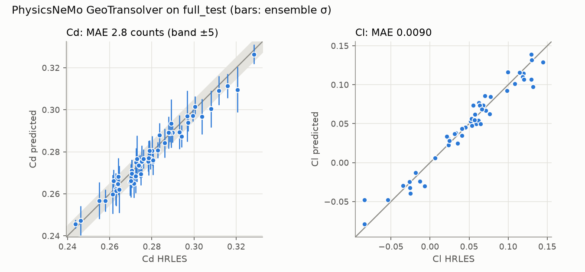
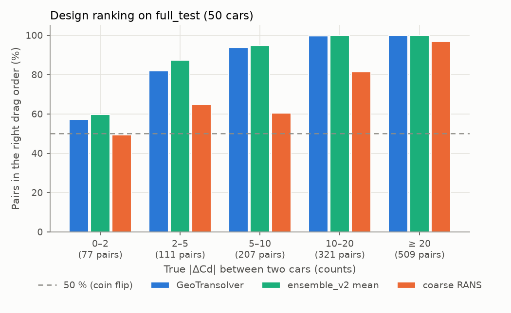

# Results

Generated by `aerosurr report` from the evaluation JSON under `~/aero/runs` and the store; sections appear once their runs finish.

## Surrogates on `full_test` (50 cars, native mesh)

Field errors are area-weighted relative L2. Forces come from integrating the
predicted fields over the native cells (1 count = 0.001 Cd).

| Model | Test cars | Cp rel L2 | Cf_x rel L2 | Cf_z rel L2 | Cd MAE (counts) | Cd max (counts) | Cd R² | Cl MAE |
|---|---|---|---|---|---|---|---|---|
| PointNet baseline (in-house) | 50 | 0.296 | 0.315 | 0.496 | 21.8 | 84.4 | -1.492 | 0.0509 |
| PhysicsNeMo Transolver | 50 | 0.064 | 0.079 | 0.131 | 3.9 | 13.1 | 0.923 | 0.0090 |
| PhysicsNeMo GeoTransolver | 50 | 0.061 | 0.076 | 0.126 | 2.8 | 11.2 | 0.959 | 0.0090 |

Main model, selected on `full_val` Cd MAE (3.13 counts): **PhysicsNeMo GeoTransolver**.

## Design ranking on `full_test` (50 cars, 1225 pairs)

For design work the order of candidates and the size of a drag difference matter more than absolute Cd. A pair is in the right order when the predicted and true Cd differences have the same sign. The error on a drag difference is |(p_i − p_j) − (t_i − t_j)| over all pairs; a constant bias cancels in it. The lowest-drag pick is the car with the lowest predicted Cd: its true rank, its distance from the true best and the overlap of the predicted and true top 5. Coarse RANS is the in-house OpenFOAM case of each car (SPEC §5.3). From `aerosurr eval ranking` (`geotransolver_main_v1/ranking_full_test.json`).

| Predictor | Cd MAE (counts) | Bias | Spearman | Pairs ≥ 5 counts apart in order | ΔCd error mean / p90 (counts) | Lowest-drag pick | Top-5 overlap |
|---|---|---|---|---|---|---|---|
| GeoTransolver | 2.82 | -1.40 | 0.979 | 98.6 % | 3.82 / 7.88 | `run_124`: true rank 1, 0.00 counts off | 5/5 |
| ensemble_v2 mean | 1.90 | -0.59 | 0.984 | 98.9 % | 2.85 / 6.24 | `run_284`: true rank 2, 2.57 counts off | 4/5 |
| coarse RANS | 9.49 | +4.21 | 0.805 | 84.9 % | 11.85 / 24.05 | `run_284`: true rank 2, 2.57 counts off | 3/5 |

Pairs in the right drag order, by band of true |ΔCd|:

| True \|ΔCd\| (counts) | Pairs | GeoTransolver | ensemble_v2 mean | coarse RANS |
|---|---|---|---|---|
| 0–2 | 77 | 57.1 % | 59.7 % | 49.4 % |
| 2–5 | 111 | 82.0 % | 87.4 % | 64.9 % |
| 5–10 | 207 | 93.7 % | 94.7 % | 60.4 % |
| 10–20 | 321 | 99.7 % | 100.0 % | 81.3 % |
| ≥ 20 | 509 | 100.0 % | 100.0 % | 97.1 % |

Other coefficients (MAE in counts, Spearman):

| Predictor | Coefficient | MAE (counts) | Spearman |
|---|---|---|---|
| GeoTransolver | cl | 9.04 | 0.968 |
| GeoTransolver | clf | 4.58 | 0.993 |
| GeoTransolver | clr | 6.16 | 0.984 |
| GeoTransolver | cd_pressure | 2.82 | 0.977 |
| GeoTransolver | cd_friction | 0.09 | 0.996 |
| coarse RANS | Cl | 66.80 | 0.792 |
| coarse RANS | Clf | 28.30 | 0.945 |
| coarse RANS | Clr | 39.20 | 0.808 |

## Data efficiency (nested official splits)

HF-only Transolver trained on `super_scarce` ⊂ `scarce` ⊂ `medium` ⊂ `full` with
the same 20k-step budget each. At that budget the curve flattens beyond ~70 cars:
400 cars get only 50 epochs. The main run (400 cars, 60k steps) shows the gain from
training longer.

| Training runs | Steps | Cp rel L2 | Cd MAE (counts) |
|---|---|---|---|
| 11 | 20k | 0.173 | 15.7 |
| 67 | 20k | 0.093 | 6.4 |
| 133 | 20k | 0.093 | 5.3 |
| 400 | 20k | 0.089 | 6.7 |
| 400 | 60k (main) | 0.061 | 2.8 |

## Multi-fidelity correction (coarse RANS → HRLES)

- LF alone (coarse RANS mapped onto the HF mesh, 50 test cars): Cp rel L2 0.303, Cd MAE 8.8 counts.

Every model is evaluated on the same 50 LF-mapped `full_test` cars. Values are mean ± std (ddof 1) [min, max] over 3 seed(s); a seed sets the initialisation and the data order. Every seed uses the same nested training cars, so the variation across training subsets is not covered. MF − HF-only is paired by seed (seeds 0 / 1 / 2; negative = MF better). The verdict names a winner only when the two models' seed ranges do not overlap and the paired difference has the same sign in every seed; otherwise the difference is *within seed spread*. LF alone and the scalar correction are deterministic for a given set of training cars, so they are single values.

**Result:** Cd MAE: MF better at 11 cars, within seed spread at 25 and 50 cars; Cp: within seed spread at 11 cars, HF-only better at 25 and 50 cars; Cf_x: HF-only better at 11, 25 and 50 cars; Cf_y: HF-only better at 11, 25 and 50 cars; Cf_z: HF-only better at 11, 25 and 50 cars.

Cd MAE (counts):

| Training cars | HF only | MF (LF inputs, residual) | MF − HF-only per seed | Mean difference | Verdict | Scalar Cd_HF = a + b·Cd_LF |
|---|---|---|---|---|---|---|
| 11 | 15.9 ± 1.4 [15.0, 17.4] | 8.9 ± 0.4 [8.5, 9.1] | -6.7 / -6.0 / -8.3 | -7.0 | MF better | 10.9 |
| 25 | 10.6 ± 0.9 [9.5, 11.1] | 11.0 ± 1.8 [9.4, 12.9] | +3.4 / -1.8 / -0.2 | +0.5 | within seed spread | 8.3 |
| 50 | 6.2 ± 0.9 [5.3, 7.1] | 7.6 ± 1.4 [6.5, 9.2] | +3.0 / +1.2 / +0.1 | +1.4 | within seed spread | 8.3 |

Field errors (area-weighted relative L2):

| Training cars | Field | HF only | MF | MF − HF-only per seed | Mean difference | Verdict |
|---|---|---|---|---|---|---|
| 11 | cp | 0.171 ± 0.006 [0.167, 0.178] | 0.171 ± 0.003 [0.167, 0.174] | +0.006 / -0.002 / -0.007 | -0.001 | within seed spread |
| 11 | cf_x | 0.175 ± 0.005 [0.170, 0.179] | 0.205 ± 0.004 [0.201, 0.209] | +0.032 / +0.031 / +0.026 | +0.030 | HF-only better |
| 11 | cf_y | 0.329 ± 0.001 [0.328, 0.330] | 0.408 ± 0.005 [0.402, 0.413] | +0.084 / +0.073 / +0.081 | +0.079 | HF-only better |
| 11 | cf_z | 0.295 ± 0.004 [0.292, 0.300] | 0.340 ± 0.004 [0.336, 0.343] | +0.051 / +0.042 / +0.042 | +0.045 | HF-only better |
| 25 | cp | 0.117 ± 0.004 [0.113, 0.122] | 0.136 ± 0.001 [0.135, 0.137] | +0.020 / +0.022 / +0.013 | +0.018 | HF-only better |
| 25 | cf_x | 0.130 ± 0.005 [0.126, 0.135] | 0.163 ± 0.003 [0.161, 0.166] | +0.037 / +0.036 / +0.026 | +0.033 | HF-only better |
| 25 | cf_y | 0.255 ± 0.008 [0.249, 0.264] | 0.329 ± 0.004 [0.327, 0.334] | +0.081 / +0.078 / +0.064 | +0.074 | HF-only better |
| 25 | cf_z | 0.216 ± 0.007 [0.210, 0.223] | 0.275 ± 0.004 [0.273, 0.280] | +0.064 / +0.064 / +0.049 | +0.059 | HF-only better |
| 50 | cp | 0.097 ± 0.001 [0.096, 0.098] | 0.111 ± 0.002 [0.110, 0.114] | +0.016 / +0.015 / +0.012 | +0.014 | HF-only better |
| 50 | cf_x | 0.113 ± 0.001 [0.111, 0.114] | 0.134 ± 0.002 [0.132, 0.137] | +0.023 / +0.021 / +0.019 | +0.021 | HF-only better |
| 50 | cf_y | 0.223 ± 0.003 [0.220, 0.226] | 0.268 ± 0.005 [0.265, 0.275] | +0.052 / +0.046 / +0.039 | +0.045 | HF-only better |
| 50 | cf_z | 0.185 ± 0.002 [0.182, 0.186] | 0.223 ± 0.005 [0.220, 0.228] | +0.042 / +0.038 / +0.034 | +0.038 | HF-only better |

## Deep ensemble, calibrated on `full_val`, reported on `full_test`

Reported ensemble: **5 × PhysicsNeMo GeoTransolver, main-model budget** (`ensemble_v2`, 5 members).

| Ensemble | Quantity | 50 % | 90 % | 95 % | NLL | Spearman(σ, \|err\|) |
|---|---|---|---|---|---|---|
| ensemble_v2 | cp (per cell) | 0.55 | 0.90 | 0.94 | -2.95 | 0.60 |
| ensemble_v2 | cf_x (per cell) | 0.53 | 0.91 | 0.95 | -7.76 | 0.70 |
| ensemble_v2 | cf_y (per cell) | 0.53 | 0.91 | 0.95 | -8.16 | 0.74 |
| ensemble_v2 | cf_z (per cell) | 0.53 | 0.91 | 0.95 | -8.20 | 0.75 |
| ensemble_v2 | Cd (per car) | 0.64 | 0.88 | 0.92 | – | -0.11 |
| ensemble_v1 | cp (per cell) | 0.55 | 0.92 | 0.96 | -2.69 | 0.63 |
| ensemble_v1 | cf_x (per cell) | 0.53 | 0.91 | 0.95 | -7.44 | 0.72 |
| ensemble_v1 | cf_y (per cell) | 0.53 | 0.91 | 0.95 | -7.79 | 0.75 |
| ensemble_v1 | cf_z (per cell) | 0.54 | 0.92 | 0.95 | -7.86 | 0.75 |
| ensemble_v1 | Cd (per car) | 0.48 | 0.94 | 0.98 | – | 0.19 |

| Ensemble | Members | Ensemble-mean Cd MAE (counts) | Mean calibrated σ(Cd) (counts) | Cd temperature | Aleatoric share |
|---|---|---|---|---|---|
| ensemble_v2 (5 × PhysicsNeMo GeoTransolver, main-model budget) | 5 | 1.9 | 3.3 | 2.53 | 91% |
| ensemble_v1 (5 × PhysicsNeMo Transolver, 20k steps) | 5 | 4.7 | 6.6 | 2.24 | 94% |

**Ensemble-mean forces (ensemble_v2):** Cd MAE 1.9 counts (max 7.7), Cd R² 0.978, over 50 test cars.
Per-car σ(Cd) is calibrated in coverage, but its rank correlation with the Cd error (-0.11) is indistinguishable from zero at n = 50 (standard error ≈ 0.14): it says how large drag errors are on average, not which cars are worst.

### Per-car Cd uncertainty, like for like (`full_test`, 50 cars)

σ_epi(Cd) is the std over members of each member's integrated Cd (ddof = 0); the error is the ensemble-mean Cd minus HRLES. Calibrated rows use one temperature fitted on `full_val`. In this pipeline the reported per-car σ(Cd) already is that member spread (the aleatoric share above is per-cell field variance), so the *current* and *epistemic, calibrated* rows must coincide; the second recomputes it from saved per-member Cd, and here they do. Spearman CIs are percentile bootstraps over cars (10,000).

| Ensemble | σ(Cd) | Temperature | Mean σ (counts) | 50 % | 90 % | 95 % | Spearman(σ, \|err\|) [95 % CI] |
|---|---|---|---|---|---|---|---|
| ensemble_v2 | current (reported above) | 2.53 | 3.3 | 0.64 | 0.88 | 0.92 | -0.11 [-0.42, +0.20] |
| ensemble_v2 | epistemic, raw | 1 | 1.3 | 0.36 | 0.64 | 0.70 | -0.11 [-0.42, +0.20] |
| ensemble_v2 | epistemic, calibrated | 2.53 | 3.3 | 0.64 | 0.88 | 0.92 | -0.11 [-0.42, +0.20] |
| ensemble_v1 | current (reported above) | 2.24 | 6.6 | 0.48 | 0.94 | 0.98 | +0.19 [-0.09, +0.45] |
| ensemble_v1 | epistemic, raw | 1 | 2.9 | 0.30 | 0.50 | 0.60 | +0.19 [-0.09, +0.45] |
| ensemble_v1 | epistemic, calibrated | 2.24 | 6.6 | 0.48 | 0.94 | 0.98 | +0.19 [-0.09, +0.45] |

## Out-of-distribution check: `geometry_test` (OOD, 97 cars) vs `geometry_val` (ID, 48 cars)

`ensemble_ood_v1`: 5 heteroscedastic GeoTransolver members with ensemble_v2's config and budget, trained on the official `geometry` split (339 training cars; normalisation statistics from those cars only) and kept apart from every `full`-split result. Test cars are the 20 % most isolated STL surfaces (mean Chamfer RMS distance to the 10 nearest public geometries, the dataset's `ood_score`); val cars come from the training-side population. Temperatures are fitted on the val cars, so the ID side is calibrated by construction and the OOD side shows what survives the shift. σ below is calibrated; per-cell means are cell means per car, averaged over cars.

**Result: yes, σ rises out of distribution in step with the error, on a mild shift.** On the 97 most isolated geometries the errors grow by ×1.17 per cell (Cp) and ×1.28 in Cd (2.0 → 2.6 counts); calibrated σ grows by ×1.11 and ×1.28, and per-cell 90 % coverage on the OOD side is 0.89–0.90. Per car, mean σ(Cp) tells OOD from ID cars with AUROC 0.82 [0.75, 0.89] and σ(Cd) with 0.68 [0.58, 0.77], while the Cd error itself only reaches 0.57 [0.47, 0.66]. σ follows geometric novelty (Spearman with `ood_score`: 0.61 [0.48, 0.70] for σ(Cp), 0.34 [0.19, 0.48] for σ(Cd), ID + OOD) more than the Cd error does (0.10 [-0.07, 0.26]). So σ works as a novelty flag; it still does not rank individual cars' Cd errors (Spearman +0.13 [-0.08, +0.33] on the OOD cars). The shift stays inside the DrivAer notchback morph family; it does not validate σ for other vehicle types.

### Does σ rise out of distribution?

| Quantity | ID (val) | OOD (test) | OOD / ID | Error ID | Error OOD | Error OOD / ID | Verdict |
|---|---|---|---|---|---|---|---|
| σ(cp) per cell | 0.02153 | 0.02396 | 1.11 | 0.01489 | 0.01734 | 1.17 | σ rises in step with the error |
| σ(cf_x) per cell | 0.0001964 | 0.0002132 | 1.09 | 0.000153 | 0.0001731 | 1.13 | σ rises in step with the error |
| σ(cf_y) per cell | 0.0001561 | 0.0001691 | 1.08 | 0.000124 | 0.0001379 | 1.11 | σ rises in step with the error |
| σ(cf_z) per cell | 0.0001504 | 0.0001617 | 1.08 | 0.0001197 | 0.0001335 | 1.11 | σ rises in step with the error |
| σ(Cd) per car (counts) | 3.40 | 4.33 | 1.28 | 2.00 | 2.56 | 1.28 | σ rises in step with the error |

Error columns: mean |err| per cell for fields, Cd MAE for σ(Cd).

### Does per-car σ flag the OOD cars?

| Score | AUROC (OOD test vs ID val) [95 % CI] | Reading |
|---|---|---|
| σ(Cd) per car | 0.68 [0.58, 0.77] | better than chance |
| mean per-cell σ(Cp) per car | 0.82 [0.75, 0.89] | better than chance |
| \|Cd error\| per car (reference: how separable the errors are) | 0.57 [0.47, 0.66] | chance level |

| Spearman with geometric novelty (`ood_score`) | Cars | ρ [95 % CI] | Reading |
|---|---|---|---|
| σ(Cd), OOD test cars | 97 | +0.20 [+0.00, +0.39] | weakly positive (CI lower bound ≈ 0) |
| σ(Cd), ID + OOD | 145 | +0.34 [+0.19, +0.48] | positive |
| mean per-cell σ(Cp), ID + OOD | 145 | +0.61 [+0.48, +0.70] | positive |
| \|Cd error\|, OOD test cars (reference) | 97 | +0.00 [-0.20, +0.21] | indistinguishable from zero |
| \|Cd error\|, ID + OOD (reference) | 145 | +0.10 [-0.07, +0.26] | indistinguishable from zero |

### Calibration on the OOD side (temperatures from ID val)

| Quantity | 50 % | 90 % | 95 % | NLL | Spearman(σ, \|err\|) [95 % CI] |
|---|---|---|---|---|---|
| cp (per cell) | 0.54 | 0.90 | 0.94 | -2.79 | 0.61 [0.60, 0.62] |
| cf_x (per cell) | 0.51 | 0.89 | 0.93 | -7.56 | 0.70 [0.70, 0.70] |
| cf_y (per cell) | 0.52 | 0.89 | 0.94 | -8.00 | 0.74 [0.74, 0.74] |
| cf_z (per cell) | 0.51 | 0.89 | 0.94 | -8.04 | 0.74 [0.74, 0.75] |
| Cd (per car, ID val) | 0.60 | 0.88 | 0.92 | – | -0.21 [-0.48, +0.08] |
| Cd (per car, OOD test) | 0.65 | 0.92 | 0.96 | – | +0.13 [-0.08, +0.33] |

Per-cell Spearman CIs bootstrap whole cars (2,000 cells each, 500 resamples); per-car CIs bootstrap cars (10,000 resamples). ID per-cell coverage is not listed: the temperatures are fitted there.

## Compute

Hardware: AMD Threadripper 9980X (64 cores) and 2 × RTX 5090, one workstation.
GPU-hours are training wall time on one GPU, from each run's `summary.json`;
evaluation and the store build are not included.

| Work | Runs | GPU-hours |
|---|---|---|
| Main models | 2 | 5.3 |
| Ensembles (v1, v2) | 10 | 16.6 |
| OOD ensemble | 5 | 10.7 |
| Data efficiency | 4 | 3.3 |
| Multi-fidelity study (MF + HF-only, 3 seeds) | 18 | 13.1 |
| Baseline (PointNet) | 1 | 0.2 |
| Smoke test | 1 | 0.2 |
| **Total** | **41** | **49.3** |

Coarse RANS (OpenFOAM, one case at a time on 24 cores): 100 cases, median 12.7 min per case, 21.3 h in all (`total_s` of each case).
