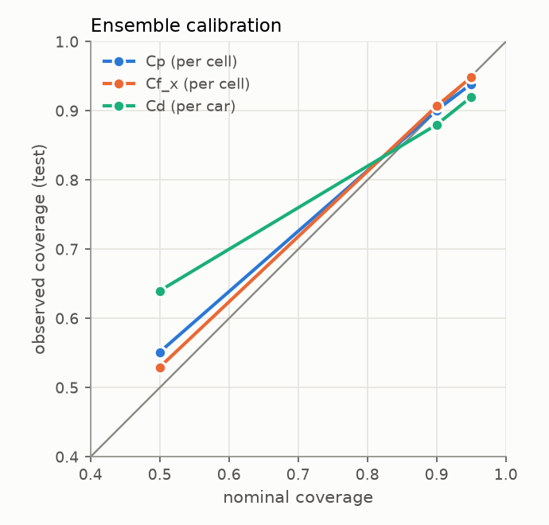

# Results

Generated by `aerosurr report` from the evaluation JSON under `~/aero/runs` and the store; sections appear once their runs finish.

## Surrogates on `full_test` (50 cars, native mesh)

Field errors are area-weighted relative L2. Forces come from integrating the
predicted fields over the native cells (1 count = 0.001 Cd).

| Model | Test cars | Cp rel L2 | Cf_x rel L2 | Cf_z rel L2 | Cd MAE (counts) | Cd max (counts) | Cd R² | Cl MAE |
|---|---|---|---|---|---|---|---|---|
| PointNet baseline (in-house) | 50 | 0.296 | 0.315 | 0.496 | 21.8 | 84.4 | -1.492 | 0.0509 |
| PhysicsNeMo Transolver | 50 | 0.064 | 0.079 | 0.131 | 3.9 | 13.1 | 0.923 | 0.0090 |
| PhysicsNeMo GeoTransolver | 50 | 0.061 | 0.076 | 0.126 | 2.8 | 11.2 | 0.959 | 0.0090 |

Main model, selected on `full_val` Cd MAE (3.13 counts): **PhysicsNeMo GeoTransolver**.

## Data efficiency (nested official splits)

HF-only Transolver trained on `super_scarce` ⊂ `scarce` ⊂ `medium` ⊂ `full` with
the same 20k-step budget each. At that budget the curve flattens beyond ~70 cars:
400 cars get only 50 epochs. The main run (400 cars, 60k steps) shows the gain from
training longer.

| Training runs | Steps | Cp rel L2 | Cd MAE (counts) |
|---|---|---|---|
| 11 | 20k | 0.173 | 15.7 |
| 67 | 20k | 0.093 | 6.4 |
| 133 | 20k | 0.093 | 5.3 |
| 400 | 20k | 0.089 | 6.7 |
| 400 | 60k (main) | 0.061 | 2.8 |

## Multi-fidelity correction (coarse RANS → HRLES)

- LF alone (coarse RANS mapped onto the HF mesh, 3 test cars): Cp rel L2 0.298, Cd MAE 19.6 counts.
## Deep ensemble, calibrated on `full_val`, reported on `full_test`

Reported ensemble: **5 × PhysicsNeMo GeoTransolver, main-model budget** (`ensemble_v2`, 5 members).

| Ensemble | Quantity | 50 % | 90 % | 95 % | NLL | Spearman(σ, \|err\|) |
|---|---|---|---|---|---|---|
| ensemble_v2 | cp (per cell) | 0.55 | 0.90 | 0.94 | -2.95 | 0.60 |
| ensemble_v2 | cf_x (per cell) | 0.53 | 0.91 | 0.95 | -7.76 | 0.70 |
| ensemble_v2 | cf_y (per cell) | 0.53 | 0.91 | 0.95 | -8.16 | 0.74 |
| ensemble_v2 | cf_z (per cell) | 0.53 | 0.91 | 0.95 | -8.20 | 0.75 |
| ensemble_v2 | Cd (per car) | 0.64 | 0.88 | 0.92 | – | -0.11 |
| ensemble_v1 | cp (per cell) | 0.55 | 0.92 | 0.96 | -2.69 | 0.63 |
| ensemble_v1 | cf_x (per cell) | 0.53 | 0.91 | 0.95 | -7.44 | 0.72 |
| ensemble_v1 | cf_y (per cell) | 0.53 | 0.91 | 0.95 | -7.79 | 0.75 |
| ensemble_v1 | cf_z (per cell) | 0.54 | 0.92 | 0.95 | -7.86 | 0.75 |
| ensemble_v1 | Cd (per car) | 0.48 | 0.94 | 0.98 | – | 0.19 |

| Ensemble | Members | Ensemble-mean Cd MAE (counts) | Mean calibrated σ(Cd) (counts) | Cd temperature | Aleatoric share |
|---|---|---|---|---|---|
| ensemble_v2 (5 × PhysicsNeMo GeoTransolver, main-model budget) | 5 | 1.9 | 3.3 | 2.53 | 91% |
| ensemble_v1 (5 × PhysicsNeMo Transolver, 20k steps) | 5 | 4.7 | 6.6 | 2.24 | 94% |

**Ensemble-mean forces (ensemble_v2):** Cd MAE 1.9 counts (max 7.7), Cd R² 0.978, over 50 test cars.
Per-car σ(Cd) is calibrated in coverage, but its rank correlation with the Cd error (-0.11) is indistinguishable from zero at n = 50 (standard error ≈ 0.14): it says how large drag errors are on average, not which cars are worst.

