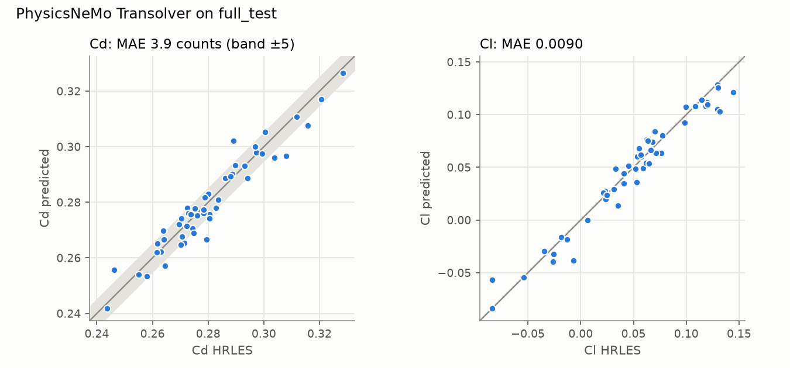
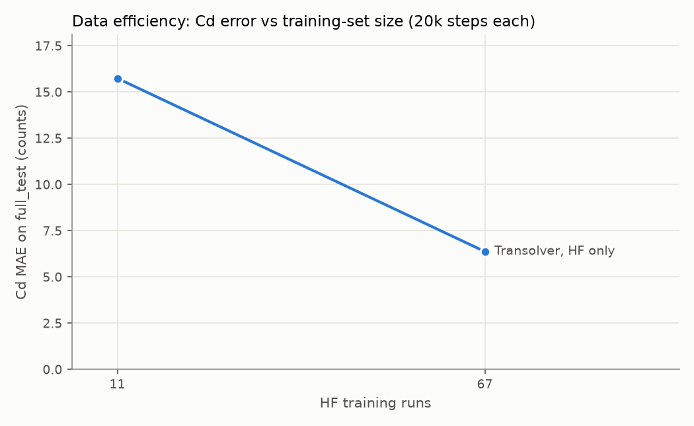

# Results

Generated by `aerosurr report` from the evaluation JSON under `~/aero/runs` and the store; sections appear once their runs finish.

## Surrogates on `full_test` (50 cars, native mesh)

Field errors are area-weighted relative L2. Forces come from integrating the
predicted fields over the native cells (1 count = 0.001 Cd).

| Model | Test cars | Cp rel L2 | Cf_x rel L2 | Cf_z rel L2 | Cd MAE (counts) | Cd max (counts) | Cd R² | Cl MAE |
|---|---|---|---|---|---|---|---|---|
| PointNet baseline (in-house) | 50 | 0.296 | 0.315 | 0.496 | 21.8 | 84.4 | -1.492 | 0.0509 |
| PhysicsNeMo Transolver | 50 | 0.064 | 0.079 | 0.131 | 3.9 | 13.1 | 0.923 | 0.0090 |

## Data efficiency (nested official splits)

| Training runs | Cp rel L2 | Cd MAE (counts) |
|---|---|---|
| 11 | 0.173 | 15.7 |
| 67 | 0.093 | 6.4 |

## Multi-fidelity correction (coarse RANS → HRLES)

- LF alone (coarse RANS mapped onto the HF mesh, 3 test cars): Cp rel L2 0.298, Cd MAE 19.6 counts.
